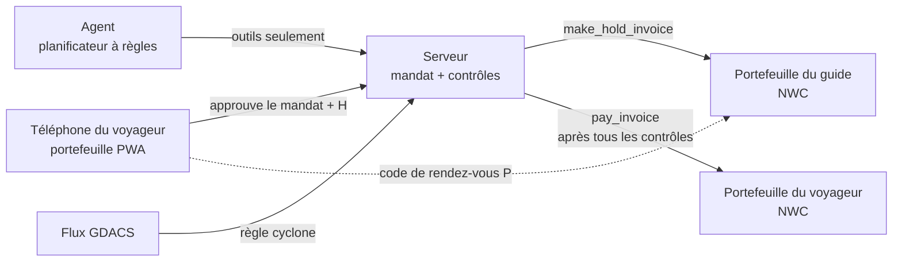

# GuideSats (nom provisoire)

**Un agent de voyage IA réserve un petit guide touristique mauricien et le paie en sats sur Lightning, mais seulement dans un mandat que le voyageur approuve et que l'agent ne peut pas modifier.**
Les sats attendent dans une facture « hold » jusqu'à ce que le voyageur montre un code de rendez-vous au guide.
Si une alerte cyclone GDACS pour Maurice arrive avant l'excursion, la facture est annulée et le voyageur est remboursé automatiquement.

[English version: README.md](README.md) · Réalisé pour le Dakar Bitcoin Hack 2026 · Licence MIT

> **Ce qui est réel, ce qui est simulé.** La démo tourne sur un Lightning **SIMULÉ** : un registre en mémoire avec factures « hold » et une chaîne simulée (un bloc toutes les 10 minutes), marqué SIMULÉ sur chaque écran. Il écrit de vraies factures BOLT11, mais avec le préfixe regtest et sans signature : aucun portefeuille sur un vrai réseau ne pourrait les payer. L'adaptateur **Nostr Wallet Connect** est testé contre un faux client, et son parcours « hold » a été lancé sur NWC contre les portefeuilles de test NWC Faucet d'Alby : des portefeuilles de test aux soldes fictifs, qui n'existent qu'à l'intérieur d'un seul Alby Hub ([ce qui a tourné](#lancer-sur-nwc-optionnel)). Le décodage des factures, les contrôles, le mandat, l'agent et la règle cyclone sont le même code dans les deux cas, à une différence près. Avec de vrais portefeuilles, le bénéficiaire est la clé retrouvée à partir de la signature de la facture. Les factures simulées ne sont pas signées : leur bénéficiaire vient de l'étiquette `n`, acceptée uniquement sur regtest.

## Lancer (une commande)

Il faut Node 22.13 ou plus récent. Ni compte, ni clé, ni Docker.

```bash
npm install && npm run demo
```

Ouvrez http://127.0.0.1:8787 sur cette machine (le serveur n'écoute que sur 127.0.0.1). La vue prévue est une fenêtre de la largeur d'un téléphone. Données de départ : un portefeuille voyageur de 120 000 sats et trois guides fictifs avec leurs excursions. Les excursions commencent dans l'heure, dans la fenêtre de blocage : l'agent peut donc bloquer tout de suite. Si le serveur tourne depuis un moment, appuyez d'abord sur **Réinitialiser la démo** (onglet Agent).

Le parcours principal prend environ 30 secondes :

1. **Portefeuille voyageur** : choisissez *Randonnée au lever du soleil au Morne Brabant*, puis **Réserver**. Le brouillon de mandat affiche le plafond, la clé du guide, la fenêtre de temps et « un seul paiement ».
2. **Approuver le mandat**. Votre navigateur crée un secret P, le garde, et n'envoie que H = SHA-256(P).
3. **Demander à l'agent de bloquer les sats**. La console de l'agent montre chaque appel d'outil. Les sats passent dans une facture « hold ».
4. La carte affiche le **code de rendez-vous** (P) en QR code et en texte.
5. Onglet **Guide** : collez le code, puis appuyez sur **Encaisser**. Le guide reçoit 21 000 sats.
   - Dans cette démo locale, les deux écrans sont sur la même machine, d'où le copier-coller.
   - Sur un téléphone dont le navigateur a `BarcodeDetector` (Chrome sur Android), l'écran du guide propose aussi **Scanner le QR**. Ce scan et le QR n'ont pas encore été testés avec une vraie caméra.
6. Onglet **Agent** :
   - **Pousser l'agent à trop dépenser** utilise les outils de l'agent contre une réservation approuvée : une facture trois fois au-dessus du plafond, le bon montant vers un autre guide, `approve_mandate` et `raise_cap`. La console montre les quatre tentatives refusées.
   - **Déclencher une alerte cyclone GDACS** (un rejeu de la vraie fiche BELAL-24) rembourse automatiquement toute réservation bloquée.
   - **Laisser expirer une facture « hold » impayée** : l'agent demande la facture sans la payer, et l'horloge dépasse son expiration. La carte de réservation propose alors **Approuver à nouveau (nouveau code)** : le téléphone crée un nouveau secret, et l'ancien code comme l'ancienne facture ne pourront plus jamais servir.
   - **Avancer de 13 h** montre un « hold » qui dépasse son échéance (24 blocs) et rembourse.

Vous pouvez aussi écrire une demande à l'agent, en français ou en anglais : *« je veux voir la cascade de Chamarel »*.

**Plan B (portefeuilles sans facture « hold »).**
1. Choisissez **Payer après l'excursion** et approuvez le mandat (pas de secret).
2. Faites **Avancer de 13 h**.
3. Appuyez sur **L'excursion a eu lieu : confirmer**.
4. Appuyez sur **Demander à l'agent de payer le guide**.

L'agent ne paie que la facture que l'appli a elle-même demandée au portefeuille du guide, après votre confirmation, dans le plafond et la fenêtre.

## Tester

```bash
npm run check        # typecheck + 185 tests (unitaires, propriété, API) + les 6 scénarios de bout en bout ; hors ligne, sans clé
npm run e2e:sim      # les six scénarios de démo, sous forme de rapport
npm run test:e2e     # Playwright à 360 px (EN) et 412 px (FR) ; une fois avant : npx playwright install chromium
```

Tests clés :

- **Test de propriété** (fast-check). Il génère des suites aléatoires d'appels d'outils de l'agent : factures forgées, rejouées, croisées entre réservations ou illisibles, sauts d'horloge, blocs minés d'un coup, alertes cyclone, rapprochements, factures expirées suivies d'une nouvelle approbation du voyageur. Il vérifie ensuite **sur le registre** que le voyageur n'a jamais payé :
  - au-dessus d'un plafond ;
  - un bénéficiaire hors mandat ;
  - deux fois sur un même mandat ;
  - une empreinte que le voyageur n'a pas approuvée ;
  - une réservation non approuvée.
- **Vecteur de test de la spécification BOLT11.** Le bénéficiaire est retrouvé à partir de la signature avec `@noble/curves`.
- **Règle cyclone sur des données GDACS enregistrées.** BELAL-24 (orange, Maurice) annule l'excursion ; FREDDY-23, GARANCE-25, HONDE-25, GAMANE-24 et FILIPO-24 ne l'annulent pas.
- **Instantané (snapshot) des journaux.** Aucun préimage, chaîne NWC, nom, e-mail ou téléphone n'y survit.
- **Rapprochement.** Un paiement à l'issue inconnue est tranché d'après le portefeuille du guide, une seule fois, même quand le paiement, la surveillance, la règle cyclone, le voyageur et le guide agissent en même temps.
- **Rejeu.** Après une facture expirée, l'ancienne empreinte, l'ancienne facture et l'ancien secret sont refusés.
- **Limite du « hold ».** Échéances en hauteur de bloc ou en heure Unix, marge de 6 blocs, « hold » annulé tout de suite quand la limite du portefeuille est trop courte.

## Le problème, l'utilisateur, la portée

**Utilisateur principal : le petit guide indépendant** à Maurice. Par exemple un guide de randonnée au Morne, un bateau à Blue Bay, une famille qui guide à Chamarel.

De plus en plus de voyageurs préparent leur voyage avec des agents IA. Aujourd'hui, ces guides ont deux options :
- prendre un acompte par virement, ce qui est lent, coûteux pour les cartes étrangères et sans garantie de remboursement ;
- ne rien prendre, et perdre la journée si le client ne vient pas.

Maurice a accueilli environ 1,38 million de touristes en 2024 (chiffres de Statistics Mauritius repris par la presse). La saison cyclonique du sud-ouest de l'océan Indien va de mi-novembre à avril, et jusqu'à mi-mai pour Maurice.

**Ce qui change :**
- Le guide reçoit un engagement : un mandat approuvé dès la réservation, puis les sats bloqués dans un « hold » dans l'heure qui précède l'excursion, en sats, sur son propre portefeuille, sans frais de carte ni plateforme qui garde l'argent.
- Le voyageur ne peut pas perdre son argent à cause d'un guide absent ou d'un cyclone.
- L'agent ne peut jamais dépenser plus que ce qui a été approuvé.

**Estimation de portée (objectif pilote, pas un résultat mesuré) :** 20 guides × 5 excursions par semaine, soit environ 100 réservations et 1,5 à 2 millions de sats par semaine. Le même parcours convient à tout tourisme côtier ou saisonnier en Afrique, Sénégal compris.

## Comment ça marche

- **Mandat** : un plafond, la clé du guide, une fenêtre de temps et un usage unique. Seul le voyageur l'approuve ; l'agent n'a aucun outil pour l'approuver ou l'augmenter.
- **Contrôle de facture** : chaque facture est décodée avec `light-bolt11-decoder` avant tout paiement. On vérifie :
  - le réseau ;
  - le montant exact ;
  - que l'empreinte vaut H ;
  - l'expiration ;
  - le bénéficiaire, retrouvé à partir de la signature.
- **Un seul point de paiement** (`src/app/payments.ts`). Il réserve le mandat à usage unique de façon atomique avant de payer.
- **Facture « hold »** (NWC-03) : les sats sont bloqués, pas envoyés. Il y a trois issues :
  - le guide encaisse avec P au rendez-vous ;
  - une alerte cyclone annule ;
  - un délai expiré rembourse.
- **Limite du « hold »** (`src/domain/holdLimit.ts`) : le portefeuille du guide annule de lui-même un « hold » accepté à son échéance (`settle_deadline`). Chaque « hold » accepté est comparé à cette échéance ; s'il ne peut pas durer jusqu'au rendez-vous, il est annulé tout de suite.
- **Rapprochement** (`src/app/reconcile.ts`) : un paiement sans réponse claire est tranché d'après le portefeuille du guide (`lookup_invoice`), jamais d'après le texte d'une erreur.
- **Agent** : un planificateur à règles, donc sans clé de LLM. Un planificateur LLM utiliserait les mêmes outils, sans rien de plus.



Détails : [docs/ARCHITECTURE.md](docs/ARCHITECTURE.md). Modèle de menaces : [SECURITY.md](SECURITY.md).

## Sécurité dès la conception (en bref)

- **Modèle de menaces.** 18 menaces, chacune reliée à sa parade et au test qui la couvre ([SECURITY.md](SECURITY.md)).
- **Moindre privilège.**
  - La connexion NWC du voyageur n'a besoin que de `pay_invoice` (plus `get_budget` et `get_balance`).
  - Celle du guide n'a besoin que des méthodes « hold », de `lookup_invoice` et de `get_info`.
- **Chaînes de connexion NWC.** Elles ne sont lues que dans des variables d'environnement. `.env` est ignoré par git et jamais journalisé.
- **Le secret P.** Il est créé et gardé sur le téléphone du voyageur. L'agent ne voit jamais P ni aucun secret de portefeuille.
- **Journaux et piste d'audit.** Ils passent par un filtre de caviardage, vérifié par un test d'instantané. Aucune donnée personnelle n'est collectée.
- **Serveur local.**
  - Il n'écoute que sur 127.0.0.1 et vérifie l'en-tête Host.
  - Il n'accepte que du JSON de sa propre origine, limite la taille des requêtes et valide chaque entrée.
  - Il applique une CSP stricte.
- **Bibliothèques éprouvées.** `light-bolt11-decoder`, `@getalby/sdk`, `@noble/curves`. Versions épinglées, `npm audit` propre.

## Faible débit, téléphones milieu de gamme

- Une PWA Preact de 43 Ko minifiés (environ 16 Ko gzip), sans police web.
- Conçue d'abord pour 360 px, avec des zones tactiles de 44 px.
- Mises à jour en direct par Server-Sent Events.
- Interface en français et en anglais.

## Contraintes (honnêtes)

- **Les factures « hold » sont récentes.** NWC-03 est un brouillon et peu de portefeuilles le prennent en charge. Le plan B (paiement après l'excursion, NIP-47 de base) est intégré : rien ne bouge avant l'excursion, et en cas de cyclone rien n'est payé.
- **Un « hold » dure peu.** Le portefeuille du guide annule de lui-même un « hold » accepté à son échéance (`settle_deadline`). Sur les portefeuilles de test NWC Faucet d'Alby, cette échéance est une hauteur de bloc, 24 blocs plus loin, soit environ 4 h (mesuré le 16 nov. 2026). À la réservation, seul le mandat approuvé est enregistré, et l'agent ne peut bloquer les sats qu'à partir d'**1 h avant l'excursion** : (24 blocs − 6 de marge) × 10 minutes, moins 2 h pour un rendez-vous en retard. Chaque « hold » accepté est comparé à l'échéance que donne son portefeuille : s'il ne peut pas durer jusqu'à 2 h après le début avec 6 blocs d'avance, il est annulé tout de suite et le voyageur remboursé. Les blocs arrivent au hasard : s'ils viennent bien plus vite que la moyenne, un portefeuille peut encore annuler avant un rendez-vous très en retard, et le voyageur est alors remboursé.
- **Une facture « hold » expirée demande à nouveau le voyageur.** Elle est liée à l'empreinte H du voyageur. Si elle expire avant que l'agent la paie, le voyageur approuve à nouveau et le téléphone crée un nouveau secret ; l'ancien n'est plus jamais accepté.
- **Les budgets côté portefeuille (NWC-13) sont optionnels.** Sans budget, le mandat de l'appli reste le seul plafond.
- **Les deux portefeuilles Faucet partagent une clé de nœud.** Ce sont des sous-portefeuilles d'un même Alby Hub : le contrôle du bénéficiaire (la clé retrouvée à partir de la signature doit être celle du guide) ne peut pas les distinguer, et l'essai Faucet ne l'exerce donc pas. Il est couvert par des tests unitaires et de propriété avec des clés distinctes. De vrais guides sur leurs propres nœuds ont des clés distinctes.
- **En plan B, un paiement à l'issue inconnue reste réservé** jusqu'à ce que le portefeuille du guide indique la facture payée : un paiement ordinaire ne s'annule pas.
- **GDACS liste les pays touchés par événement.** Un cyclone qui passe près de Maurice sans y être listé ne déclenche pas la règle.

## Indicateurs à suivre

- Les réservations bloquées par semaine, et parmi elles les parts encaissées, remboursées pour cyclone, remboursées après expiration, et remboursées tout de suite parce que la limite du « hold » était trop courte.
- Les factures « hold » expirées impayées (chacune demande une nouvelle approbation).
- Le délai entre l'approbation et le blocage.
- Le délai entre le scan du code et l'encaissement.
- Les refus classés par motif.
- Le poids de la PWA.

## Prochaine étape

1. Un essai où le voyageur et le guide sont sur deux nœuds distincts, pour exercer aussi hors des tests le contrôle de la clé du bénéficiaire.
2. Des budgets imposés par le portefeuille.
3. Les alertes de la Météo mauricienne (MMS) comme seconde source.
4. Une interface en kreol morisien.

## Lancer sur NWC (optionnel)

```bash
cp .env.example .env    # puis remplir NWC_TRAVELLER_URL, NWC_GUIDE_URL, NWC_NETWORK pour deux portefeuilles de TEST
npm run e2e:nwc         # refuse de démarrer sans ces valeurs ; deux étapes de 10 sats
```

Il a été lancé sur NWC contre les portefeuilles de test NWC Faucet d'Alby le 16 nov. 2026. Leurs soldes sont des sats fictifs qui n'existent qu'à l'intérieur d'un seul Alby Hub ; le réseau annoncé est `mainnet`, donc les factures commencent par `lnbc`. Résultats :

- Le `get_info` du guide liste les méthodes « hold » (`make_hold_invoice`, `settle_hold_invoice`, `cancel_hold_invoice`) et `lookup_invoice`. Le `get_budget` du voyageur n'a renvoyé aucun budget.
- **Encaissement :** un « hold » de 10 sats accepté, puis encaissé avec P. Le solde du voyageur a bougé de −10 sats.
- **Annulation :** un « hold » de 10 sats accepté, puis annulé, et le voyageur remboursé (écart de solde 0). L'appel `pay_invoice` du voyageur a échoué (code NIP-47 `INTERNAL`) au lieu de répondre : l'issue se lit donc sur le portefeuille du guide avec `lookup_invoice`. C'est ce que fait l'étape de rapprochement.
- **Limite du « hold » :** `lookup_invoice` a donné `settle_deadline` 976121 alors que `get_info` donnait `block_height` 976097 : une hauteur de bloc, 24 blocs plus loin, soit environ 4 h. La fenêtre de blocage en découle.
- Les deux portefeuilles annoncent la même clé de nœud (voir Contraintes).
- Un second essai le même jour a relu chaque « hold » avec `lookup_invoice` et l'a traduit avec la même fonction que l'étape de rapprochement : le « hold » annulé est ressorti `released` (état annulé côté portefeuille, écart de solde 0, alors que `pay_invoice` échouait encore avec `INTERNAL`). L'échéance était de nouveau 24 blocs plus loin (976127 contre 976103) ; un blocage fait au tout début de la fenêtre y tient, sans bloc de reste au-delà de la marge.

Cet essai pilote directement les portefeuilles. Le service de réservation lui-même (mandat, rapprochement, contrôle de la limite du « hold », nouvelle approbation) n'a tourné pour l'instant que sur le Lightning SIMULÉ.

## Crédits

- **GDACS**, système mondial d'alerte et de coordination en cas de catastrophe (ONU et Commission européenne), pour les données cyclone enregistrées.
- **La spécification BOLT11**, pour le vecteur de test.
- **Bibliothèques :**
  - `@getalby/sdk`, `light-bolt11-decoder`, `@noble/curves`, `@noble/hashes`, `@scure/base`, Hono, Preact, uqr, fast-check, Vitest, esbuild et tsx (MIT) ;
  - TypeScript et Playwright (Apache-2.0).
- Tous les guides et toutes les entreprises des données de démo sont fictifs.

Licence : [MIT](LICENSE).
