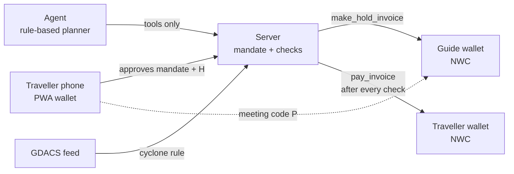

# GuideSats (working name)

**An AI travel agent books a small Mauritian tour guide and pays them in sats over Lightning, but only inside a mandate that the traveller approves and the agent cannot change.**
The sats wait in a hold invoice until the traveller shows a meeting code to the guide.
If a GDACS cyclone alert for Mauritius comes before the tour, the hold is cancelled and the traveller is refunded automatically.

[Version française : README.fr.md](README.fr.md) · Built for the Dakar Bitcoin Hack 2026 · MIT license

> **What is real and what is simulated.** The demo runs on a **SIMULATED** Lightning backend: an in-process ledger with hold invoices, labelled SIMULATED on every screen. It writes real BOLT11 invoices, but on the regtest prefix and with no signature, so no wallet on a real network could pay one. The **Nostr Wallet Connect** adapter for real wallets is written and unit-tested against a fake client. It has **not yet been run** against real wallets; that is `npm run e2e:nwc`, which needs two test wallets (see below). The invoice decoding, the checks, the mandate, the agent and the cyclone rule are the same code on both paths.

## Run it (one command)

Needs Node 22.13 or newer. No accounts, no keys, no Docker.

```bash
npm install && npm run demo
```

Open http://127.0.0.1:8787 on this machine (it binds to 127.0.0.1 only). A phone-width browser window is the intended view. Seed data: one traveller wallet with 120 000 sats and three fictional guides with tours.

The happy path takes about 30 seconds:

1. **Traveller wallet**: pick *Le Morne Brabant sunrise hike*, then **Book**. The draft mandate shows the cap, the guide's key, the time window and "one payment only".
2. **Approve mandate**. Your browser makes a secret P, keeps it, and sends only H = SHA-256(P).
3. **Ask the agent to lock the sats**. The agent console shows each tool call. The sats move into a hold invoice.
4. The card shows the **meeting code** (P). Copy it.
5. **Guide** tab: paste the code and press **Settle**. The guide is paid 21 000 sats.
6. **Agent** tab: **Trigger GDACS cyclone alert** (a replay of the real BELAL-24 record). Any locked booking is refunded automatically. **Skip ahead 13 h** shows a hold timing out and refunding.

You can also type a request for the agent, in English or French: *"book the lagoon boat"* or *"je veux voir la cascade de Chamarel"*.

**Plan B (wallets without hold invoices).** Choose **Pay after the tour** on a tour card and approve the mandate (no secret is needed). Use **Skip ahead 13 h**, then **The tour happened: confirm**, then **Ask the agent to pay the guide**. The agent pays only an invoice that the app itself asked the guide's wallet for, only after you confirm, and only inside the cap and the window.

## Test it

```bash
npm run check        # typecheck + 122 unit/property/API tests + the 4 end-to-end scenarios; offline, no keys
npm test             # unit, property and API tests only (Vitest)
npm run e2e:sim      # the four demo scenarios (settle, cyclone refund, refusals, plan B), printed as a report
npm run test:e2e     # Playwright smoke at 360 px (EN) and 412 px (FR); needs `npx playwright install chromium` once
```

Key tests:

- `tests/agent/property.test.ts`: **fast-check** generates 500 random sequences of up to 40 agent tool calls. They include forged, replayed, swapped, cross-booking and garbage invoices, clock jumps, cyclone flips and a plan-B booking. It then checks **on the ledger** that the traveller never paid:
  - above a cap;
  - a payee outside a mandate;
  - one mandate twice;
  - an unapproved booking;
  - outside the mandate's time window.

  It is mutation-checked: switching off the invoice check, or the mandate check, makes it fail.
- `tests/ln/invoiceCheck.test.ts`: checks run against the **BOLT11 spec test vector**. The payee is recovered from the signature with `@noble/curves`. The suite refuses a wrong network, amount or hash, an expired invoice and a wrong payee.
- `tests/domain/cyclone.test.ts`: the cyclone rule on **recorded GDACS data**: BELAL-24 (Orange, Mauritius) cancels. FREDDY-23, GARANCE-25, HONDE-25, GAMANE-24 and FILIPO-24 do not.
- `tests/log/redact.test.ts`: a **snapshot** showing that no preimage, NWC string, name, email or phone number survives in logs.

## The problem, the user, the reach

**Primary user: the small independent tour guide** in Mauritius. Think of a hiking guide at Le Morne, a boat operator at Blue Bay, or a family guiding at Chamarel. More and more travellers plan trips with AI agents. Today these guides either take a deposit by bank transfer (slow, expensive for foreign cards, and nothing guarantees a refund) or take no deposit and lose the day when the guest does not come. Mauritius receives roughly 1.3 million tourist arrivals a year, and the cyclone season runs from November to April.

**What changes:**

- The guide gets a commitment before the day, paid in sats to their own wallet, with no card fees and no platform holding the money.
- The traveller cannot lose the money to a no-show guide or to a cyclone, and the agent can never spend more than they approved.
- Neither side has to trust the agent.

**Reach estimate (pilot target, not a measured result):** 20 guides × 5 tours a week = about 100 bookings a week, about 1.5 to 2 million sats a week through the guides' own wallets. The same flow fits any coastal or seasonal tourism market in Africa, Senegal included.

## How it works



- **Mandate** (`src/domain/mandate.ts`): cap, the guide's key, a time window, single use. Only the traveller approves it; the agent has no tool to approve or raise one.
- **Invoice check** (`src/ln/invoiceCheck.ts`): every invoice is decoded with `light-bolt11-decoder` and checked (network, exact amount, hash = H, expiry, and the payee recovered from the signature) before any payment.
- **One choke point** (`src/app/payments.ts`): the only code that pays. It reserves the single-use mandate atomically before paying.
- **Hold invoice** (NWC-03): the sats are locked, not sent. The guide settles with P at the meeting; a cyclone alert cancels; a timeout refunds.
- **Agent** (`src/agent/`): a rule-based planner, so no LLM key is needed. An LLM planner could use the same tools and get nothing more.

Details: [docs/ARCHITECTURE.md](docs/ARCHITECTURE.md). Threat model: [SECURITY.md](SECURITY.md). Event rules checklist: [docs/RULES.md](docs/RULES.md).

## Security by design (short)

- A threat model with 15 threats, each mapped to its mitigation and the test that covers it ([SECURITY.md](SECURITY.md)).
- Least privilege. The traveller's NWC connection needs only `pay_invoice` (plus `get_budget` and `get_balance`). The guide's needs only the hold-invoice methods and `lookup_invoice`.
- NWC connection strings are read only from env vars. `.env` is git-ignored and never logged. The real SDK is loaded only on the opt-in real path.
- The preimage P is made and kept on the traveller's phone. The agent never sees P or any wallet secret.
- Logs and the audit trail go through a redactor, with a snapshot test. No PII is collected.
- The local server binds to 127.0.0.1, checks the Host header against an allow-list, takes POSTs only as JSON from its own origin, limits bodies, sets a strict CSP and validates every input.
- Proven libraries: `light-bolt11-decoder`, `@getalby/sdk`, `@noble/curves` and `@noble/hashes`. Exact version pins and `npm audit` clean.

## Low bandwidth, mid-range phones

- The Preact PWA is 28 KB minified (about 11 KB gzipped) plus 5 KB of CSS, with no web fonts and no images beyond one SVG icon.
- It is designed for 360 px first, with 44 px touch targets. It works in light and dark mode.
- An app-shell service worker caches the shell, while API calls always go to the network.
- Live updates use Server-Sent Events, not polling.
- English and French; the language follows the browser and can be switched at any time.

## Constraints (honest)

- **Hold invoices are young.** NWC-03 is a draft and few wallets support it. For wallets without it, plan B (pay on completion, core NIP-47 only) is built in. No money moves before the tour, and a cyclone means nothing is paid. It gives the guide less certainty than a hold.
- **Hold time is limited** by the Lightning HTLC timeout. So the agent locks the sats close to the tour (from 12 h before; to be measured on the first real run), and at booking only the approved mandate is recorded.
- **Wallet budgets (NWC-13) are optional.** When a wallet offers no budget, the app's mandate is the only cap.
- **Test wallets on one shared node** sign invoices with the same node key, which weakens the payee check between them. Real guides on their own wallets do not have this problem.
- **After settlement, a refund** is a new payment that the guide starts. That is out of scope for v1.
- **GDACS lists affected countries per event**, so a near miss that GDACS does not list for Mauritius does not trigger the rule.

## Metrics to track

- Bookings locked per week; the share settled, the share refunded for a cyclone and the share refunded because the hold expired.
- Time from the traveller's approval to the lock, and from the scan of the meeting code to the settlement (the guide's payout time).
- Refusals by reason (`invoice_wrong_amount`, `invoice_wrong_payee`, `mandate_already_used`...). This is the security signal.
- Payment failures and unknown outcomes that need reconciliation.
- PWA weight and time to interactive on a 3G profile.

## Next iteration

1. The **first real NWC run** on two test wallets. It checks the hold-method gate, records `get_budget` and the real `settle_deadline`, then does one lock and settle and one lock, cancel and refund.
2. A **QR code** for the meeting code, scanned by the guide's phone camera.
3. **Wallet-enforced budgets** (NWC-13) on a self-hosted wallet, so the cap is enforced twice.
4. A second cyclone feed: the class warnings of the **Mauritius Meteorological Services**.
5. A **Kreol Morisien** user interface, and an optional LLM planner behind the same tools.

## Still needed before submission (team steps)

- Two NWC **test wallets** (traveller and guide). Their connection strings go only in a local `.env`.
- The **public repository** and its final name ("GuideSats" is a working name).
- The **3-minute demo video** (script: [docs/demo-script.md](docs/demo-script.md)).
- **Joining the event** and submitting on Devpost.

## Real run (opt-in)

```bash
cp .env.example .env    # then fill NWC_TRAVELLER_URL, NWC_GUIDE_URL, NWC_NETWORK for two TEST wallets
npm run e2e:nwc         # refuses to start without those values; moves at most 10 sats per step
```

## Credits

- GDACS, the Global Disaster Alert and Coordination System, a cooperation framework of the United Nations and the European Commission. The cyclone fixtures in `fixtures/gdacs/` were recorded from its public event API.
- The BOLT11 specification (lightning/bolts) for the test vector in `fixtures/bolt11/`.
- Libraries:
  - `@getalby/sdk` (MIT);
  - `light-bolt11-decoder` (MIT);
  - `@noble/curves`, `@noble/hashes` and `@scure/base` (MIT);
  - Hono (MIT);
  - Preact (MIT);
  - fast-check (MIT);
  - Vitest (MIT);
  - esbuild (MIT);
  - tsx (MIT);
  - TypeScript (Apache-2.0);
  - Playwright (Apache-2.0).
- All guides, businesses and people in the seed data are fictional.

License: [MIT](LICENSE).
