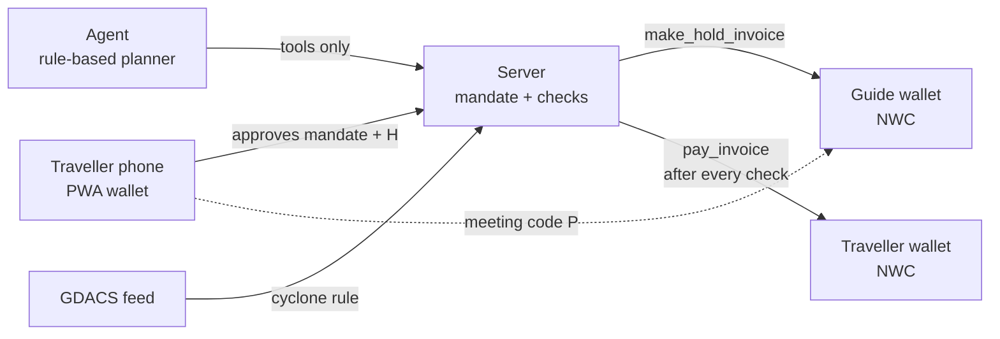

# GuideSats

**An AI travel agent books a small Mauritian tour guide and pays them in sats over Lightning, but only inside a mandate that the traveller approves and the agent cannot change.**
The sats wait in a hold invoice until the traveller shows a meeting code to the guide.
If a GDACS cyclone alert for Mauritius comes before the tour, the hold is cancelled and the traveller is refunded automatically.

[Version française : README.fr.md](README.fr.md) · Built for the Dakar Bitcoin Hack 2026 · MIT license

> **What is real and what is simulated.** The demo runs on a **SIMULATED** Lightning backend: an in-process ledger with hold invoices and a simulated chain (one block every 10 minutes), labelled SIMULATED on every screen. It writes real BOLT11 invoices, but on the regtest prefix and with no signature, so no wallet on a real network could pay one. The **Nostr Wallet Connect** adapter is unit-tested against a fake client, and its hold-invoice path was run over NWC against Alby's NWC Faucet test wallets: test wallets with dummy balances that exist only inside one Alby Hub ([what ran](#run-over-nwc-opt-in)). The invoice decoding, the checks, the mandate, the agent and the cyclone rule are the same code on both paths, with one difference. On real wallets the payee is the key recovered from the invoice signature (tested on the BOLT11 spec vector). Simulated invoices are unsigned, so there the payee comes from the invoice's explicit `n` tag, which the checker accepts only on regtest.

## Run it (one command)

Needs Node 22.13 or newer. No accounts, no keys, no Docker.

```bash
npm install && npm run demo
```

Open http://127.0.0.1:8787 on this machine (it binds to 127.0.0.1 only). A phone-width browser window is the intended view. Seed data: one traveller wallet with 120 000 sats and three fictional guides with tours. The tours start within the hour, inside the lock window, so the agent may lock at once. If the server has been running for a while, press **Reset demo** (Agent tab) first.

The happy path takes about 30 seconds:

1. **Traveller wallet**: pick *Le Morne Brabant sunrise hike*, then **Book**. The draft mandate shows the cap, the guide's key, the time window and "one payment only".
2. **Approve mandate**. Your browser makes a secret P, keeps it, and sends only H = SHA-256(P).
3. **Ask the agent to lock the sats**. The agent console shows each tool call. The sats move into a hold invoice.
4. The card shows the **meeting code** (P) as a QR code and as text.
5. **Guide** tab: paste the code, then press **Settle**. The guide is paid 21 000 sats. In this local demo both screens are on one machine, so you paste. On a phone whose browser has `BarcodeDetector` (such as Chrome on Android), the guide's screen also offers **Scan QR**. That scan path and the QR itself have not yet been tested with a real camera.
6. **Agent** tab:
   - **Push the agent to overspend** drives the agent's own tools against an approved booking. It sends a 3× over-cap invoice, the right amount to another guide, `approve_mandate` and `raise_cap`. The console shows all four refused.
   - **Trigger GDACS cyclone alert** (a replay of the real BELAL-24 record) refunds any locked booking automatically.
   - **Let a hold invoice expire unpaid**: the agent asks for the hold invoice but does not pay it, and the clock skips past its expiry. The booking card then asks for **Approve again (new code)**: the phone makes a new secret, and the old code and the old invoice can never be used again.
   - **Skip ahead 13 h** shows a hold passing its settle deadline (24 blocks) and refunding.

You can also type a request for the agent, in English or French: *"book the lagoon boat"* or *"je veux voir la cascade de Chamarel"*.

**Plan B (wallets without hold invoices).** Choose **Pay after the tour** on a tour card and approve the mandate (no secret is needed). Use **Skip ahead 13 h**, then **The tour happened: confirm**, then **Ask the agent to pay the guide**. The agent pays only an invoice that the app itself asked the guide's wallet for, only after you confirm, and only inside the cap and the window.

## Test it

```bash
npm run check        # typecheck + 190 unit/property/API tests + the 6 end-to-end scenarios; offline, no keys
npm test             # unit, property and API tests only (Vitest)
npm run e2e:sim      # the six demo scenarios (settle, cyclone refund, refusals, plan B, re-approval, hold limit), as a report
npm run test:e2e     # Playwright: 5 flows at 360 px (EN) and 412 px (FR); needs `npx playwright install chromium` once
```

Key tests:

- `tests/agent/property.test.ts`: **fast-check** generates 500 random sequences of up to 40 agent tool calls. They include forged, replayed, swapped, cross-booking and garbage invoices, clock jumps, blocks mined at once, cyclone flips, reconcile ticks, expired hold invoices with the traveller's re-approvals, and a plan-B booking. It then checks **on the ledger** that the traveller never paid:
  - above a cap;
  - a payee outside a mandate;
  - one mandate twice;
  - a hash the traveller did not approve;
  - an unapproved booking;
  - outside the mandate's time window.

  It is mutation-checked: switching off the invoice check, or the mandate check, makes it fail.
- `tests/ln/invoiceCheck.test.ts`: checks run against the **BOLT11 spec test vector**. The payee is recovered from the signature with `@noble/curves`. The suite refuses a wrong network, amount or hash, an expired invoice and a wrong payee.
- `tests/domain/cyclone.test.ts`: the cyclone rule on **recorded GDACS data**: BELAL-24 (Orange, Mauritius) cancels. FREDDY-23, GARANCE-25, HONDE-25, GAMANE-24 and FILIPO-24 do not.
- `tests/log/redact.test.ts`: a **snapshot** showing that no preimage, NWC string, name, email or phone number survives in logs.
- `tests/app/reconcile.test.ts`: unknown pay outcomes resolved from the guide's wallet, exactly once, while the pay path, the watcher, the cyclone rule, the traveller and the guide race.
- `tests/app/reapproval.test.ts`: an expired hold invoice needs a new secret; the old hash, the old invoice and the old secret are refused (replay test).
- `tests/domain/holdLimit.test.ts` and `tests/app/lock-window.test.ts`: block-height and unix-time settle deadlines, the 6-block margin, and holds cancelled at once when the wallet's limit is too short.

## The problem, the user, the reach

**Primary user: the small independent tour guide** in Mauritius. Think of a hiking guide at Le Morne, a boat operator at Blue Bay, or a family guiding at Chamarel. More and more travellers plan trips with AI agents. Today these guides either take a deposit by bank transfer (slow, expensive for foreign cards, and nothing guarantees a refund) or take no deposit and lose the day when the guest does not come. Mauritius received about 1.38 million tourist arrivals in 2024 (as reported from Statistics Mauritius figures). The South-West Indian Ocean cyclone season runs from mid-November to April, and to mid-May for Mauritius.

**What changes:**

- The guide gets a commitment: an approved mandate at booking, then the sats locked in a hold in the hour before the tour, paid to their own wallet with no card fees and no platform holding the money.
- The traveller cannot lose the money to a no-show guide or to a cyclone, and the agent can never spend more than they approved.
- Neither side has to trust the agent.

**Reach estimate (pilot target, not a measured result):** 20 guides × 5 tours a week = about 100 bookings a week, about 1.5 to 2 million sats a week through the guides' own wallets. The same flow fits any coastal or seasonal tourism market in Africa, Senegal included.

## How it works



- **Mandate** (`src/domain/mandate.ts`): cap, the guide's key, a time window, single use. Only the traveller approves it; the agent has no tool to approve or raise one.
- **Invoice check** (`src/ln/invoiceCheck.ts`): every invoice is decoded with `light-bolt11-decoder` and checked (network, exact amount, hash = H, expiry, and the payee recovered from the signature) before any payment.
- **One choke point** (`src/app/payments.ts`): the only code that pays. It reserves the single-use mandate atomically before paying.
- **Hold invoice** (NWC-03): the sats are locked, not sent. The guide settles with P at the meeting; a cyclone alert cancels; a timeout refunds.
- **Hold limit** (`src/domain/holdLimit.ts`): the guide's wallet cancels an accepted hold by itself at its `settle_deadline`. Every accepted hold is checked against that deadline; one that could not last until the meeting is cancelled at once.
- **Reconcile step** (`src/app/reconcile.ts`): a payment without a clear answer is resolved from the guide's wallet (`lookup_invoice`), never from error text.
- **Agent** (`src/agent/`): a rule-based planner, so no LLM key is needed. An LLM planner could use the same tools and get nothing more.

Details: [docs/ARCHITECTURE.md](docs/ARCHITECTURE.md). Threat model: [SECURITY.md](SECURITY.md).

## Security by design (short)

- A threat model with 18 threats, each mapped to its mitigation and the test that covers it ([SECURITY.md](SECURITY.md)).
- Least privilege. The traveller's NWC connection needs only `pay_invoice` (plus `get_budget` and `get_balance`). The guide's needs only the hold-invoice methods, `lookup_invoice` and `get_info`.
- NWC connection strings are read only from env vars. `.env` is git-ignored and never logged. The real SDK is loaded only on the opt-in real path.
- The preimage P is made and kept on the traveller's phone. The agent never sees P or any wallet secret.
- Logs and the audit trail go through a redactor, with a snapshot test. No PII is collected.
- The local server binds to 127.0.0.1, checks the Host header against an allow-list, takes POSTs only as JSON from its own origin, limits bodies, sets a strict CSP and validates every input.
- Proven libraries: `light-bolt11-decoder`, `@getalby/sdk`, `@noble/curves` and `@noble/hashes`. Exact version pins and `npm audit` clean.

## Low bandwidth, mid-range phones

- The Preact PWA is 43 KB minified (about 16 KB gzipped, QR encoder included) plus 5 KB of CSS, with no web fonts and no images beyond one SVG icon.
- It is designed for 360 px first, with 44 px touch targets. It works in light and dark mode.
- An app-shell service worker caches the shell, while API calls always go to the network.
- Live updates use Server-Sent Events, not polling.
- English and French; the language follows the browser and can be switched at any time.

## Constraints (honest)

- **Hold invoices are young.** NWC-03 is a draft and few wallets support it. For wallets without it, plan B (pay on completion, core NIP-47 only) is built in. No money moves before the tour, and a cyclone means nothing is paid. It gives the guide less certainty than a hold.
- **Hold time is short.** The guide's wallet cancels an accepted hold by itself at its `settle_deadline`. On Alby's NWC Faucet test wallets that deadline is a block height 24 blocks ahead, about 4 h (measured on 16 Nov 2026). So at booking only the approved mandate is recorded, and the agent may lock the sats only from **50 min before the tour**: (24 blocks − a 6-block margin − 1 block of slack) × 10 minutes, minus a 2 h meeting buffer. Every accepted hold is checked against the deadline its own wallet reports. If it could not last until 2 h after the tour start with 6 blocks to spare, it is cancelled at once and the traveller refunded. Blocks arrive at random: if they come much faster than average, a wallet can still cancel a hold before a very late meeting, and the traveller is then refunded.
- **An expired hold invoice needs the traveller again.** A hold invoice is bound to the traveller's hash H. If it expires before the agent pays it, the traveller approves again and the phone makes a new secret; the old one is never accepted again.
- **Wallet budgets (NWC-13) are optional.** When a wallet offers no budget, the app's mandate is the only cap.
- **The two faucet wallets share one node key.** They are sub-wallets of one Alby Hub, so the payee check (the key recovered from the invoice signature must be the guide's) cannot tell them apart, and the faucet run does not exercise it. It is covered by unit and property tests with distinct keys. Real guides on their own nodes have distinct keys.
- **In plan B, an unknown payment stays reserved** until the guide's wallet reports the invoice settled, because a plain payment cannot be cancelled.
- **After settlement, a refund** is a new payment that the guide starts. That is out of scope for v1.
- **GDACS lists affected countries per event**, so a near miss that GDACS does not list for Mauritius does not trigger the rule.

## Metrics to track

- Bookings locked per week; the share settled, the share refunded for a cyclone, the share refunded because the hold expired, and the share refunded at once because a wallet's hold limit was too short.
- Hold invoices that expired unpaid (each one needs the traveller to approve again).
- Time from the traveller's approval to the lock, and from the scan of the meeting code to the settlement (the guide's payout time).
- Refusals by reason (`invoice_wrong_amount`, `invoice_wrong_payee`, `mandate_already_used`...). This is the security signal.
- Payment failures and unknown outcomes that need reconciliation.
- PWA weight and time to interactive on a 3G profile.

## Next iteration

1. A run with the traveller and the guide on **two separate nodes**, so the payee-key check is exercised outside the tests too.
2. **Wallet-enforced budgets** (NWC-13) on a self-hosted wallet, so the cap is enforced twice.
3. A second cyclone feed: the class warnings of the **Mauritius Meteorological Services**.
4. A **Kreol Morisien** user interface, and an optional LLM planner behind the same tools.
5. Camera QR scanning on browsers without `BarcodeDetector` (a small decoder library).

## Run over NWC (opt-in)

```bash
cp .env.example .env    # then fill NWC_TRAVELLER_URL, NWC_GUIDE_URL, NWC_NETWORK for two TEST wallets
npm run e2e:nwc         # refuses to start without those values; two steps of 10 sats
```

It was run over NWC against Alby's NWC Faucet test wallets on 16 Nov 2026. Their balances are dummy sats that exist only inside one Alby Hub; the network is reported as `mainnet`, so the invoices start with `lnbc`. What it showed:

- The guide's `get_info` lists the hold methods (`make_hold_invoice`, `settle_hold_invoice`, `cancel_hold_invoice`) and `lookup_invoice`. The traveller's `get_budget` returned no budget.
- **Settle:** a 10-sat hold was accepted, then settled with P. The traveller's balance moved by −10 sats.
- **Cancel:** a 10-sat hold was accepted, then cancelled, and the traveller was refunded (balance change 0). The traveller's `pay_invoice` call failed (NIP-47 code `INTERNAL`) instead of returning, so the outcome is read back from the guide's wallet with `lookup_invoice`. That is what the reconcile step does.
- **Hold limit:** `lookup_invoice` gave `settle_deadline` 976121 while `get_info` gave `block_height` 976097: a block height 24 blocks ahead, about 4 h. The lock window above is derived from it.
- Both wallets report the same node key (see Constraints).
- A second run the same day read each hold back with `lookup_invoice` and mapped it with the same function the reconcile step uses: the cancelled hold came out `released` (wallet state cancelled, traveller balance change 0, while `pay_invoice` again failed with `INTERNAL`). The deadline was again 24 blocks ahead (976127 against 976103); a lock made at the earliest moment of the window then fitted with 0 blocks to spare beyond the margin, so the window now keeps 1 block of slack.

That run drives the wallets directly. The booking service itself (mandate, reconcile step, hold-limit check, re-approval) has so far run only on the SIMULATED backend.

## Credits

- GDACS, the Global Disaster Alert and Coordination System, a cooperation framework of the United Nations and the European Commission. The cyclone fixtures in `fixtures/gdacs/` were recorded from its public event API.
- The BOLT11 specification (lightning/bolts) for the test vector in `fixtures/bolt11/`.
- Libraries:
  - `@getalby/sdk` (MIT);
  - `light-bolt11-decoder` (MIT);
  - `@noble/curves`, `@noble/hashes` and `@scure/base` (MIT);
  - Hono (MIT);
  - Preact (MIT);
  - uqr (MIT), the QR encoder;
  - fast-check (MIT);
  - Vitest (MIT);
  - esbuild (MIT);
  - tsx (MIT);
  - TypeScript (Apache-2.0);
  - Playwright (Apache-2.0).
- All guides, businesses and people in the seed data are fictional.

License: [MIT](LICENSE).
