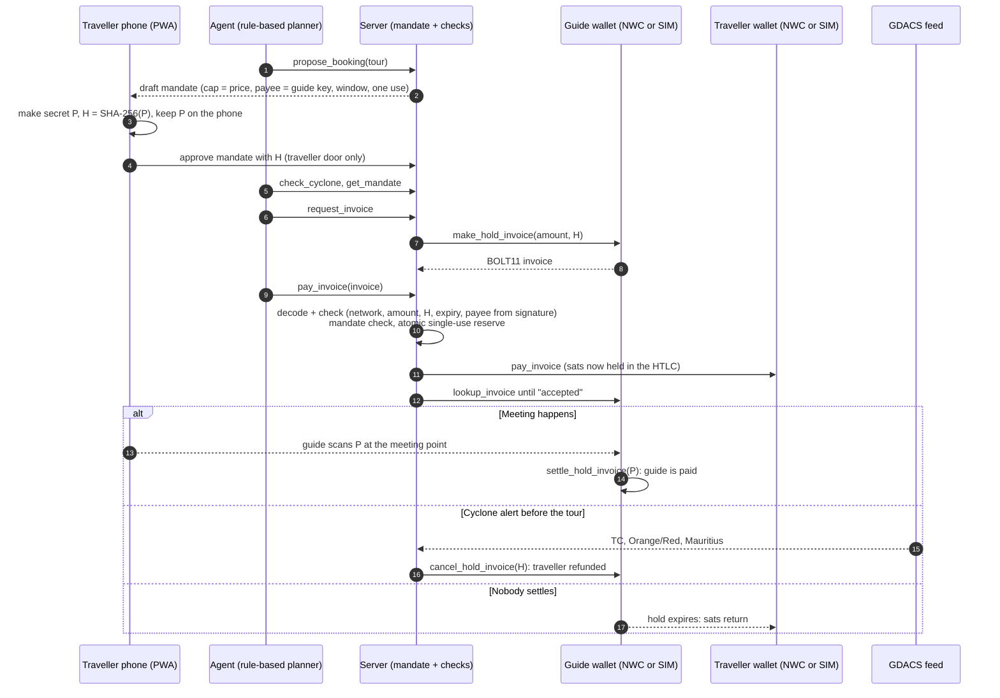
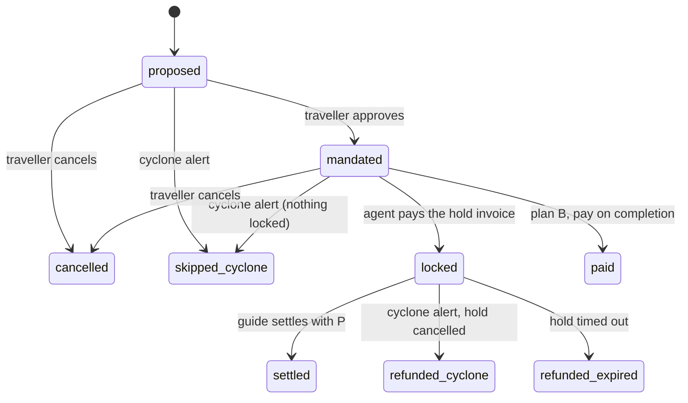

# Architecture

Small modules, one job each. Tests in `tests/` mirror `src/`.

## Modules

| Module | Job | Depends on |
|---|---|---|
| `src/domain/mandate.ts` | The spending mandate: cap, payee key, time window, single use; only the traveller approves | nothing |
| `src/domain/booking.ts` | Booking state machine (one transition table) | nothing |
| `src/domain/cyclone.ts` | The cyclone rule over GDACS event lists | nothing |
| `src/ln/bolt11.ts` | Payee recovery from a BOLT11 signature; SIMULATED invoice encoder | `@noble/curves`, `@scure/base` |
| `src/ln/invoiceCheck.ts` | Decode and check an invoice before any payment | `light-bolt11-decoder`, `bolt11.ts` |
| `src/ln/backend.ts` | The Lightning interface (payer wallet, receiver wallet) | nothing |
| `src/ln/sim.ts` | SIMULATED backend: in-process ledger with hold invoices | `bolt11.ts` |
| `src/ln/nwc.ts` | Real backend: Nostr Wallet Connect via `@getalby/sdk` (NWC-03 hold invoices) | `@getalby/sdk` (lazy) |
| `src/log/redact.ts` | Redacting JSON logger | nothing |
| `src/store/db.ts` | `node:sqlite` store; atomic mandate compare-and-set; redacted audit | `node:sqlite` |
| `src/feeds/gdacs.ts` | GDACS fixtures, demo replay, optional live read | `domain/cyclone.ts` |
| `src/app/payments.ts` | **The only caller of `payInvoice`**: every check, then pay | domain, ln, store |
| `src/app/service.ts` | Traveller, guide and agent doors; cyclone watcher; hold expiry | everything above |
| `src/app/world.ts` | Wires a SIMULATED world from `fixtures/seed.json` | service, sim |
| `src/agent/tools.ts` | The agent's tools (closure-only facade; no approve tool) | service (facade) |
| `src/agent/planner.ts` | Rule-based planner (no LLM needed); bounded run loop | tools |
| `src/server/app.ts` | Hono API + SSE; host allow-list, JSON-only POST, CSP | service, agent |
| `src/server/main.ts` | `npm run demo` on 127.0.0.1 | app, world |
| `web/src/*` | Preact PWA: traveller wallet, guide receive screen, agent console; EN + FR | API |

## Data flow

## Booking states

## Where the money checks live

All in one function, `payWithinMandate` (`src/app/payments.ts`), in this order:

1. The booking exists and is `mandated`. In plan B, the traveller must also have confirmed that the tour happened.
2. Its mandate exists and is approved. In hold mode the expected hash is the H the traveller bound. In plan B it is the hash of the invoice the app itself asked the guide's wallet for.
3. The cyclone rule says no alert for the tour.
4. `checkInvoice`: network prefix, exact amount, payment hash = H, not expiring within 60 s, payee = key recovered from the signature (or the explicit `n` tag on regtest SIMULATED invoices only).
5. `checkSpend`: cap, payee, hash, window, status.
6. Atomic compare-and-set of the mandate from `approved` to `consuming`.
7. Pay, then wait until the guide's wallet reports the hold as `accepted`. Definite failure re-arms the mandate; an unknown outcome leaves it reserved.

## Plan B: pay on completion

For wallets without hold invoices (core NIP-47 only):

- The booking's mode is `on_completion`.
- The mandate has no hash (`requireHash: false`). Its window opens at the tour start and closes 48 h after the end.
- After the traveller confirms the tour happened, the agent's `request_invoice` asks the guide's own wallet for a regular invoice (`make_invoice`), and `pay_invoice` pays only that invoice.
- The same cap, payee, single-use and cyclone checks apply.

## Two backends, one interface

`LightningBackend` (`src/ln/backend.ts`) is implemented twice:

- `SimBackend`: deterministic, in-process, regtest-only, zero-signature invoices, labelled SIMULATED. Used by `npm run demo`, the tests and `npm run e2e:sim`.
- `NwcBackend`: Nostr Wallet Connect through `@getalby/sdk` 9.0.0. Gated on `get_info` listing `make_hold_invoice`, `settle_hold_invoice` and `cancel_hold_invoice`. Used by `npm run e2e:nwc` (opt-in, needs `.env`).
