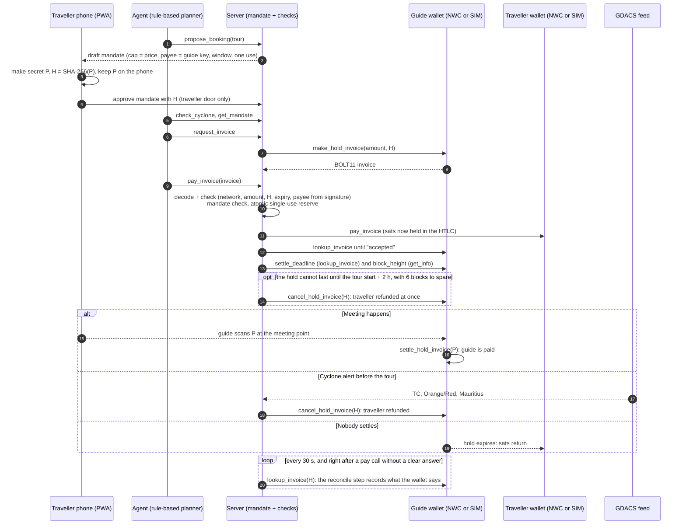
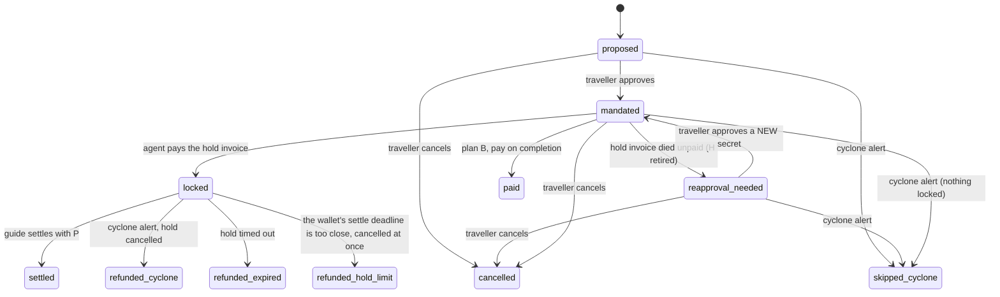

# Architecture

Small modules, one job each. Tests in `tests/` mirror `src/`.

## Modules

| Module | Job | Depends on |
|---|---|---|
| `src/domain/mandate.ts` | The spending mandate: cap, payee key, time window, single use; only the traveller approves | nothing |
| `src/domain/booking.ts` | Booking state machine (one transition table) | nothing |
| `src/domain/cyclone.ts` | The cyclone rule over GDACS event lists | nothing |
| `src/domain/holdLimit.ts` | The wallet's hold limit: `settle_deadline` as a block height or unix seconds, the 6-block margin, the lock lead | nothing |
| `src/ln/bolt11.ts` | Payee recovery from a BOLT11 signature; SIMULATED invoice encoder | `@noble/curves`, `@scure/base` |
| `src/ln/invoiceCheck.ts` | Decode and check an invoice before any payment | `light-bolt11-decoder`, `bolt11.ts` |
| `src/ln/backend.ts` | The Lightning interface (payer wallet, receiver wallet) | nothing |
| `src/ln/sim.ts` | SIMULATED backend: in-process ledger with hold invoices and a chain tip (block-height settle deadlines) | `bolt11.ts` |
| `src/ln/nwc.ts` | Real backend: Nostr Wallet Connect via `@getalby/sdk` (NWC-03 hold invoices) | `@getalby/sdk` (lazy) |
| `src/log/redact.ts` | Redacting JSON logger | nothing |
| `src/store/db.ts` | `node:sqlite` store; atomic compare-and-set on the mandate status and the booking state; redacted audit | `node:sqlite` |
| `src/feeds/gdacs.ts` | GDACS fixtures, demo replay, optional live read | `domain/cyclone.ts` |
| `src/app/payments.ts` | **The only caller of `payInvoice`**: every check, then pay | domain, ln, store, reconcile |
| `src/app/reconcile.ts` | The reconcile step: unresolved payments resolved from the guide's wallet; the hold-limit check; expired hold invoices retired | domain, ln, store |
| `src/app/service.ts` | Traveller, guide and agent doors; cyclone watcher; the 30 s reconcile tick | everything above |
| `src/app/world.ts` | Wires a SIMULATED world from `fixtures/seed.json` | service, sim |
| `src/agent/tools.ts` | The agent's tools (closure-only facade; no approve tool) | service (facade) |
| `src/agent/planner.ts` | Rule-based planner (no LLM needed); bounded run loop | tools |
| `src/server/app.ts` | Hono API + SSE; host allow-list, JSON-only POST, CSP | service, agent |
| `src/server/main.ts` | `npm run demo` on 127.0.0.1 | app, world |
| `web/src/*` | Preact PWA: traveller wallet, guide receive screen, agent console; EN + FR | API |
| `scripts/e2e-nwc-flow.ts` | The steps of `npm run e2e:nwc` (also dry-run against the simulator in the tests) | ln, reconcile, holdLimit |

## Data flow

## Booking states

## Where the money checks live

All in one function, `payWithinMandate` (`src/app/payments.ts`), in this order:

1. The booking exists and is `mandated`. In plan B, the traveller must also have confirmed that the tour happened.
2. Its mandate exists and is approved. In hold mode the expected hash is the H the traveller bound. In plan B it is the hash of the invoice the app itself asked the guide's wallet for.
3. The cyclone rule says no alert for the tour.
4. `checkInvoice`: network prefix, exact amount, payment hash = H, not expiring within 60 s, payee = key recovered from the signature (or the explicit `n` tag on regtest SIMULATED invoices only).
5. `checkSpend`: cap, payee, hash, window, status.
6. Atomic compare-and-set of the mandate from `approved` to `consuming`.
7. Pay, then wait until the guide's wallet reports the hold as `accepted`, then check it against the wallet's `settle_deadline` (the hold-limit check). Definite failure re-arms the mandate; anything else (an unknown outcome, a pay call that failed with an error) goes to the reconcile step, which decides from `lookup_invoice` and otherwise leaves the mandate reserved.

## The reconcile step

`reconcileBooking` (`src/app/reconcile.ts`) runs on the watcher's 30 s tick for every booking, and once right after a pay call ends without a clear answer. It looks the invoice up at the guide's wallet by payment hash and never reads error text:

| What it finds | Hold mode | Plan B |
|---|---|---|
| mandate `consuming`, invoice `accepted` | mandate `used`, booking `locked`, then the hold-limit check | (not a hold) |
| mandate `consuming`, invoice `settled` | mandate `used`, booking `settled` | mandate `used`, booking `paid` |
| mandate `consuming`, invoice `cancelled` or `expired` | H retired (mandate back to `pending_approval`), booking `reapproval_needed`; an `expired` one is cancelled at the wallet first; mandate `revoked` if the booking moved on | stays reserved |
| mandate `consuming`, invoice `open`, or the lookup fails | left as it is, retried | left as it is, retried |
| booking `locked` | `cancelled`/`expired` → `refunded_expired`; `settled` → `settled`; not yet checked → the hold-limit check | n/a |
| booking `mandated`, approved, cached hold invoice expired | H retired, old invoice cancelled, booking `reapproval_needed` | a fresh invoice is asked for |

Every change is a compare-and-set on the mandate status and on the booking state, so the pay path, the tick, the cyclone rule, the traveller and the guide can race and each outcome is applied once.

## The hold limit

A guide's wallet cancels an accepted hold by itself at its `settle_deadline`. On Alby's NWC Faucet test wallets (16 Nov 2026) it was a block height 24 blocks above `get_info`'s `block_height`, about 4 h. `src/domain/holdLimit.ts`:

- reads `settle_deadline` as unix seconds at 500 000 000 and above, as a block height below (the nLockTime rule);
- compares heights directly, keeping a chosen margin of 6 blocks, and converts a wait into blocks at 10 minutes each (rounded up) only where a clock time is unavoidable;
- sets the lock window: (24 − 6) × 10 min − 2 h meeting buffer = from 1 h before the tour.

After every accept, the app checks that the planned settle (tour start + 2 h) comes at least 6 blocks before the deadline; if not, or if the wallet reports no deadline (or no block height for a height deadline), the hold is cancelled at once and the booking says `refunded_hold_limit`.

## Plan B: pay on completion

For wallets without hold invoices (core NIP-47 only):

- The booking's mode is `on_completion`.
- The mandate has no hash (`requireHash: false`). Its window opens at the tour start and closes 48 h after the end.
- After the traveller confirms the tour happened, the agent's `request_invoice` asks the guide's own wallet for a regular invoice (`make_invoice`), and `pay_invoice` pays only that invoice.
- The same cap, payee, single-use and cyclone checks apply.

## Two backends, one interface

`LightningBackend` (`src/ln/backend.ts`) is implemented twice:

- `SimBackend`: deterministic, in-process, regtest-only, zero-signature invoices, labelled SIMULATED. Its chain tip advances one block every 10 minutes of the clock, and accepted holds report a block-height `settle_deadline` (24 blocks by default). Used by `npm run demo`, the tests and `npm run e2e:sim`.
- `NwcBackend`: Nostr Wallet Connect through `@getalby/sdk` 9.0.0. Gated on `get_info` listing `make_hold_invoice`, `settle_hold_invoice` and `cancel_hold_invoice`. Used by `npm run e2e:nwc` (opt-in, needs `.env`), which was run over NWC against Alby's NWC Faucet test wallets.
